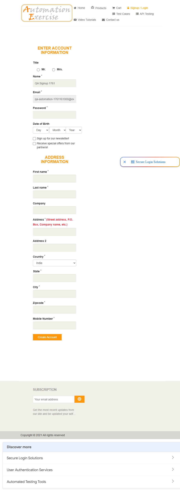
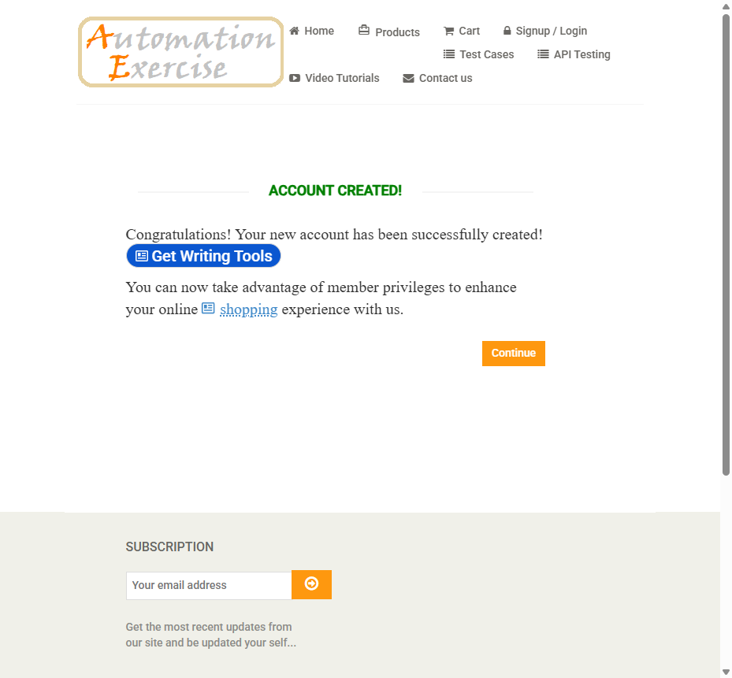
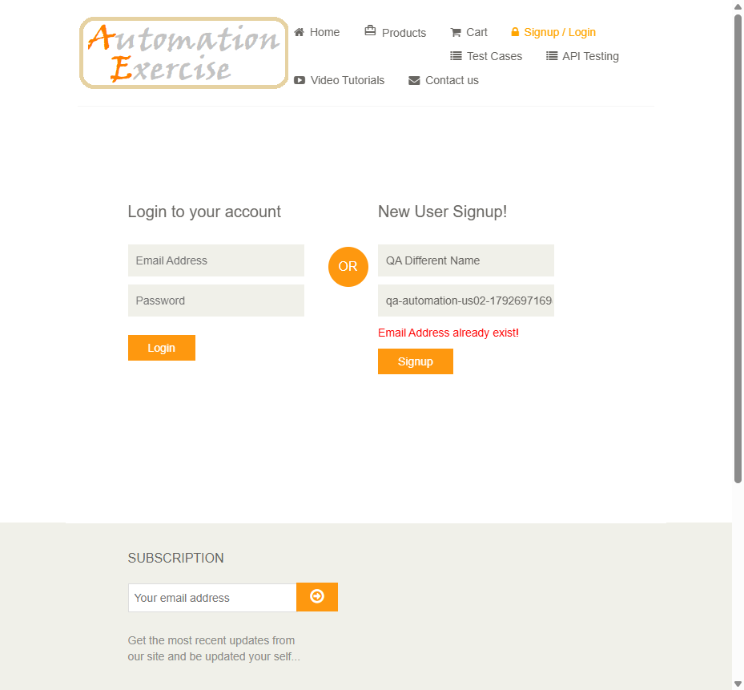
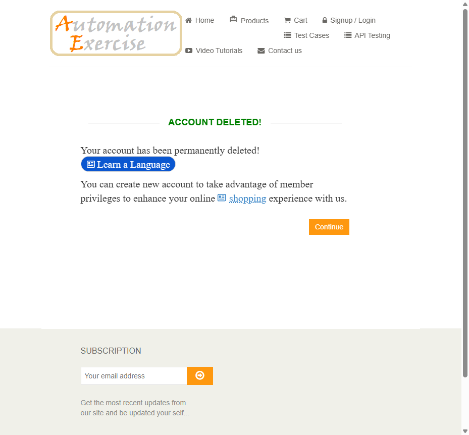

## US Reversa — Cadastro de conta (signup → criação → exclusão)

**Observado em:** https://www.automationexercise.com (`/` → `/login` → `/signup` → `/account_created` → `/` → `/delete_account`)\
**Data da análise:** 2026-10-22\
**Fluxo de chegada:** com instruções (passos do Test Case 1)\
**Pré-condições para acessar esta tela:**

  - visitante não autenticado
  - e-mail ainda não cadastrado

> Nota de escopo: o agente prevê um documento por tela. Este documento cobre as cinco telas do fluxo da US-01, cada uma como um componente, porque elas só fazem sentido em sequência.

### Narrativa
Como visitante.\
Quero criar uma conta informando meus dados pessoais e de endereço.\
Para que eu fique autenticado e possa comprar.

> ⚠️ Narrativa inferida por engenharia reversa.
> Validar com PO se reflete a intenção original.

### Critérios de Aceite
> Resumo de alto nível derivado do comportamento observado — não é o
> critério de aceite original da US. A story oficial é a US-01.

**CA01 — Home carregada**\
Dado que acesso `/`\
Quando a página termina de carregar\
Então vejo o logo, o carrossel (`#slider`) e o link "Signup / Login" no menu

**CA02 — Início do signup — origem: regra:email-signup-preservado**\
Dado que estou em `/login`\
Quando informo nome e e-mail inédito e clico em "Signup"\
Então vou para `/signup`, vejo "Enter Account Information" (exibido em maiúsculas), o Name vem preenchido com o nome do signup e o e-mail vem preenchido e desabilitado

**CA03 — Criação da conta — origem: regra:campos-obrigatorios-cadastro**\
Dado que preenchi os campos obrigatórios\
Quando clico em "Create Account"\
Então vou para `/account_created` e vejo "Account Created!" (exibido "ACCOUNT CREATED!")

**CA04 — Autenticado após Continue — origem: regra:logged-in-as-usa-campo-name**\
Dado que vejo "Account Created!"\
Quando clico em "Continue"\
Então vou para `/` e o menu mostra "Logged in as `<valor do campo Name>`", "Logout" e "Delete Account"

**CA05 — Exclusão da conta — origem: regra:exclusao-sem-confirmacao**\
Dado que estou autenticado\
Quando clico em "Delete Account"\
Então vou para `/delete_account`, vejo "Account Deleted!" (exibido "ACCOUNT DELETED!") e, depois de "Continue", o menu volta a mostrar "Signup / Login"

**CA06 — Signup com e-mail já registrado — origem: regra:email-existente-bloqueia-signup**Dado que existe uma conta com o e-mail informado (criada pela API)Quando informo um nome qualquer e esse e-mail e clico em "Signup"Então a URL passa a ser `/signup`, mas a página exibida é a de login, com "Email Address already exist!" em vermelho na caixa de signup, os campos preenchidos e sem formulário de conta

### Regras de negócio identificadas

| ID | Regra | Categoria | Confiança (tipo) | Evidência |
|----|-------|-----------|------------------|-----------|
| `regra:email-signup-preservado` | O e-mail do signup é levado ao formulário de conta, desabilitado para edição, e enviado por um campo oculto `email_address` | Validação | 1.0 (fato, confirmado ao vivo) | Observada nesta análise, ainda não está na base |
| `regra:campos-obrigatorios-cadastro` | São obrigatórios (atributo `required`): Name, Password, First name, Last name, Address, Country, State, City, Zipcode, Mobile Number. Título, data de nascimento, Company, Address 2 e as duas opções são opcionais | Validação | 1.0 (fato, confirmado ao vivo — pelo atributo `required`; a submissão com campo vazio não foi exercitada) | Observada nesta análise, ainda não está na base |
| `regra:logged-in-as-usa-campo-name` | "Logged in as" exibe o campo Name do formulário de conta, não o nome do signup nem o First name | Navegação/Acesso | 1.0 (fato, confirmado ao vivo com três valores distintos) | Observada nesta análise, ainda não está na base |
| `regra:email-existente-bloqueia-signup` | Signup com e-mail idêntico ao de uma conta existente é recusado com "Email Address already exist!"; a conta original não é alterada | Validação | 1.0 (fato, confirmado ao vivo em 2026-10-22, US-02) | Observada nesta análise, ainda não está na base |
| `regra:exclusao-sem-confirmacao` | "Delete Account" é um link GET para `/delete_account` que exclui a conta imediatamente, sem diálogo de confirmação | Navegação/Acesso | 1.0 (fato, confirmado ao vivo) | Observada nesta análise, ainda não está na base |

### Jornada do usuário

**1. Home**\
\
Estado inicial: menu com "Signup / Login", carrossel e anúncios.

**2. Enter Account Information**\
\
Depois do signup: Name pré-preenchido, e-mail desabilitado, país padrão "India".

**3. Account Created**\
\
Depois de "Create Account".

**4. Logged in as**\
\
Depois de "Continue": "Logged in as QA NameField 1761" (valor do campo Name).

**6. E-mail já existente (US-02)**Signup com e-mail de conta criada pela API: erro em vermelho, URL `/signup`.

**5. Account Deleted**\
\
Depois de "Delete Account".

### Contexto observado
O visitante informa nome e e-mail na caixa "New User Signup!" da página de login.\
O site leva a um formulário longo com dados da conta e de endereço, onde o e-mail já vem preenchido e não pode ser alterado.\
Ao criar a conta, o site confirma a criação e, depois de "Continue", mostra o usuário autenticado no menu, com as opções "Logout" e "Delete Account".\
"Delete Account" exclui a conta imediatamente e o menu volta ao estado de visitante.

### Escopo desta análise
**Coberto nesta análise:** caminho feliz completo do TC 1; obrigatoriedade pelo atributo `required`; qual nome aparece em "Logged in as"; estado após a exclusão; API de criação, consulta e exclusão de conta.

**Não coberto nesta análise:** submissão com campo obrigatório vazio; e-mail mal formado no signup; e-mail já existente (fica para a US-02); "Logout" (US-05); vignette de anúncio de tela cheia (não apareceu nesta rodada).

### Elementos identificados

#### Componente: Signup (`/login`, caixa "New User Signup!")
| Elemento | Tipo | Label/ID | Obrigatório | Comportamento observado |
|----------|------|----------|-------------|------------------------|
| Nome | input text | `[data-qa="signup-name"]` | sim | — |
| E-mail | input email | `[data-qa="signup-email"]` | sim | aceitou `@example-test.invalid` |
| Signup | button | `[data-qa="signup-button"]` | — | vai para `/signup` |

#### Componente: Formulário de conta (`/signup`)
| Elemento | Tipo | Label/ID | Obrigatório | Comportamento observado |
|----------|------|----------|-------------|------------------------|
| Título | radio | `#id_gender1` (Mr.), `#id_gender2` (Mrs.) | não | — |
| Name | input text | `[data-qa="name"]` | sim | pré-preenchido com o nome do signup; é o valor exibido em "Logged in as" |
| Email | input text | `[data-qa="email"]` | sim | pré-preenchido e **desabilitado** |
| Password | input password | `[data-qa="password"]` | sim | mascarado; `Qa!Pass1761` aceito |
| Data de nascimento | select ×3 | `[data-qa="days"]`, `[data-qa="months"]` (rótulos "January"…), `[data-qa="years"]` | não | — |
| Newsletter | checkbox | `#newsletter` — "Sign up for our newsletter!" | não | — |
| Ofertas | checkbox | `#optin` — "Receive special offers from our partners!" | não | — |
| First name / Last name | input text | `[data-qa="first_name"]`, `[data-qa="last_name"]` | sim | — |
| Company | input text | `[data-qa="company"]` | não | — |
| Address / Address 2 | input text | `[data-qa="address"]`, `[data-qa="address2"]` | sim / não | — |
| Country | select | `[data-qa="country"]` | sim | opções: India (padrão), United States, Canada, Australia, Israel, New Zealand, Singapore |
| State / City / Zipcode / Mobile | input text | `[data-qa="state"]`, `[data-qa="city"]`, `[data-qa="zipcode"]`, `[data-qa="mobile_number"]` | sim | — |
| Create Account | button | `[data-qa="create-account"]` | — | POST do formulário → `/account_created` |

#### Componente: Confirmações (`/account_created`, `/delete_account`)
| Elemento | Tipo | Label/ID | Obrigatório | Comportamento observado |
|----------|------|----------|-------------|------------------------|
| Título criado | h2 | `[data-qa="account-created"]` | — | texto "Account Created!", exibido em maiúsculas por CSS |
| Título excluído | h2 | `[data-qa="account-deleted"]` | — | texto "Account Deleted!", exibido em maiúsculas por CSS |
| Continue | link | `[data-qa="continue-button"]` | — | vai para `/` |

#### Componente: Menu do topo (`.shop-menu`)
| Elemento | Tipo | Label/ID | Obrigatório | Comportamento observado |
|----------|------|----------|-------------|------------------------|
| Signup / Login | link | `a[href="/login"]` | — | só aparece deslogado |
| Logged in as | li > a | texto "Logged in as" + `<b>` com o nome | — | só aparece logado |
| Delete Account | link | `a[href="/delete_account"]` | — | só aparece logado; exclui sem confirmação |
| Logout | link | `a[href="/logout"]` | — | só aparece logado (não exercitado) |

### Ações mapeadas
| Ação | Gatilho | Comportamento observado | Resultado |
|------|---------|------------------------|-----------|
| Signup | `signup-button` | POST `/signup` | formulário de conta |
| Criar conta | `create-account` | POST `/signup` (form_type=create_account) | `/account_created` |
| Continue | `continue-button` | GET `/` | home autenticada |
| Excluir conta | link "Delete Account" | GET `/delete_account` | conta excluída, sessão encerrada |

### Estados observados
- [x] Estado inicial (tela carregada) — home e formulário
- [ ] Estado de loading — [NÃO OBSERVADO] (navegação por página inteira, sem loading próprio)
- [ ] Estado de erro — [NÃO OBSERVADO] nesta rodada
- [x] Estado de sucesso — "Account Created!" e "Account Deleted!"
- [ ] Estado vazio — não se aplica
- [x] Estado desabilitado — campo Email no formulário de conta

### Pré-condições mapeadas
Visitante não autenticado; e-mail inédito.

### GAPs identificados

**1. Título da aba errado na exclusão**\
Em `/delete_account` o título da aba é "Automation Exercise - Account Created", e não algo como "Account Deleted". Inconsistência cosmética, fora do escopo dos critérios.

**2. Texto em maiúsculas só por CSS**\
"ENTER ACCOUNT INFORMATION", "ACCOUNT CREATED!" e "ACCOUNT DELETED!" são "Enter Account Information", "Account Created!" e "Account Deleted!" no HTML. O TC cita a forma exibida. Uma checagem que compara o texto exato do HTML com o texto do TC falharia sem que haja defeito.

**3. API responde sempre HTTP 200**\
A API de contas devolve HTTP 200 mesmo em erro, e o status real vem em `responseCode` no JSON. A documentação da API 11 diz "Response Code: 201", e esse 201 aparece só no corpo da resposta.

**4. Erros de console em toda página**\
Três erros de "Mixed Content" (fontes do Google via http) em todas as páginas. Não afetam o fluxo.

**6. Comparação de e-mail diferencia maiúsculas (inclusive no domínio)**Com uma conta `x@example-test.invalid` existente, o signup com `X@EXAMPLE-TEST.INVALID` não mostra erro e abre o formulário de conta. Pela API, tanto o e-mail todo em maiúsculas quanto só o domínio em maiúsculas criam uma segunda conta, com outro id, para a mesma caixa postal. Pela RFC 5321 (seção 2.4), o domínio não diferencia maiúsculas. Isso é GAP, não regra: o comportamento contradiz o propósito "não criar cadastro duplicado" da US-02.

**7. URL `/signup` exibindo a página de login**Depois do erro de e-mail existente, a URL é `/signup` (resultado do POST), mas o conteúdo é a página de login. Recarregar a página reenviaria o formulário. Inconsistência cosmética.

**5. Iframes de anúncio**\
A home carrega iframes de anúncio (`aswift_*`, doubleclick) e um reCAPTCHA. Nesta rodada nenhum cobriu os botões do fluxo, mas a vignette de tela cheia (`#google_vignette`) não foi descartada.
