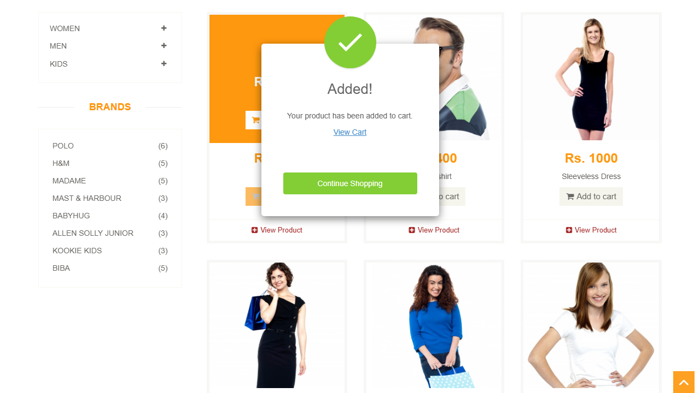
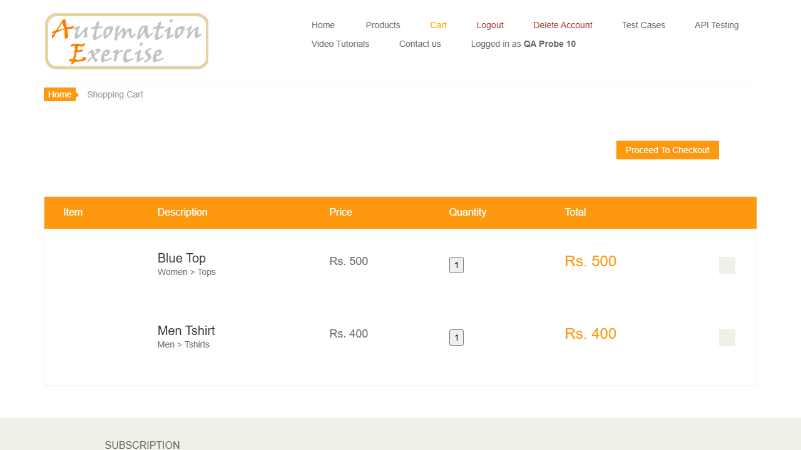
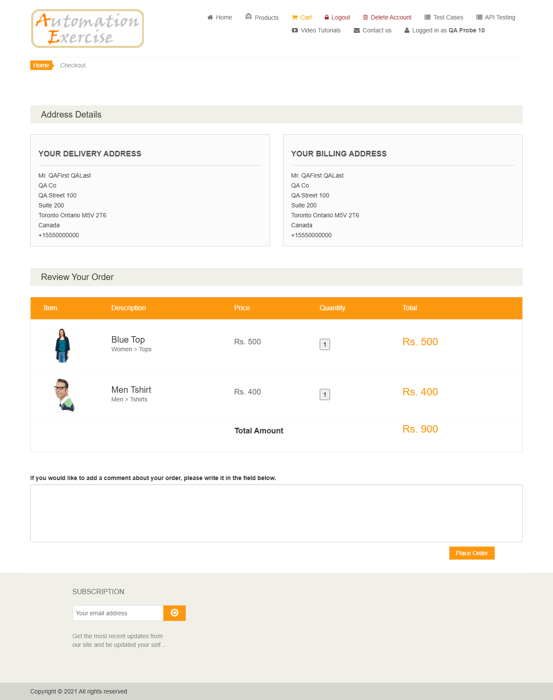
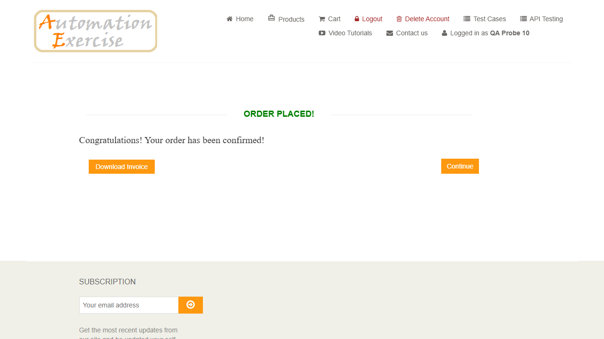
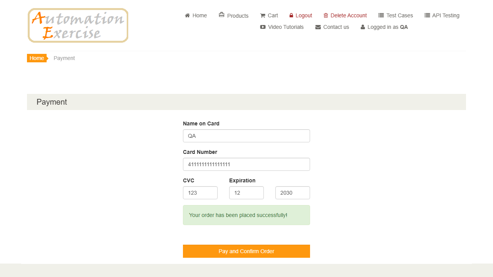

## US Reversa — Compra (carrinho → checkout → pagamento)

**Observado em:** https://www.automationexercise.com (`/` → `/view_cart` → `/checkout` → `/payment` → `/payment_done/<total>`)\
**Data da análise:** 2026-10-22\
**Fluxo de chegada:** com instruções (TC 15), com conta criada pela API e login\
**Pré-condições para acessar esta tela:**

  - cliente autenticado
  - ao menos um produto no carrinho

### Narrativa
Como cliente autenticado.\
Quero colocar produtos no carrinho, revisar e pagar.\
Para que eu conclua uma compra.

> ⚠️ Narrativa inferida por engenharia reversa.
> Validar com PO se reflete a intenção original.

### Critérios de Aceite

**CA01 — Adicionar ao carrinho**\
Dado que estou na home\
Quando clico em "Add to cart" de um produto (`.productinfo a.add-to-cart[data-product-id]`)\
Então aparece o modal `#cartModal` "Added! Your product has been added to cart." com "View Cart" e "Continue Shopping"

**CA02 — Carrinho**\
Dado que adicionei "Blue Top" (Rs. 500) e "Men Tshirt" (Rs. 400)\
Quando abro "Cart" (`/view_cart`)\
Então a tabela `#cart_info_table` lista os dois, com preço, quantidade 1 e total por linha, e o botão "Proceed To Checkout"

**CA03 — Checkout — origem: regra:checkout-usa-endereco-do-cadastro**\
Dado o carrinho acima\
Quando clico em "Proceed To Checkout"\
Então vejo "Address Details" com entrega e cobrança iguais ao cadastro, e "Review Your Order" com os itens e "Total Amount Rs. 900"

**CA04 — Pagamento — origem: regra:mensagem-sucesso-no-envio**\
Dado que escrevi um comentário e cliquei em "Place Order"\
Quando preencho o cartão (`[data-qa=name-on-card]`, `card-number`, `cvc`, `expiry-month`, `expiry-year`) e clico em "Pay and Confirm Order"\
Então "Your order has been placed successfully!" é exibida no envio e a página vai para `/payment_done/900`, com "Order Placed!" e "Congratulations! Your order has been confirmed!"; o carrinho fica vazio

**CA05 — Carrinho de visitante e login (US-11)**\
Dado que, como visitante, adicionei "Sleeveless Dress" ao carrinho\
Quando clico em "Proceed To Checkout"\
Então aparece o modal `#checkoutModal`, "Register / Login account to proceed on checkout.", com "Register / Login" e "Continue On Cart"; depois do login, o carrinho ainda tem o produto

### Regras de negócio identificadas

| ID | Regra | Categoria | Confiança (tipo) | Evidência |
|----|-------|-----------|------------------|-----------|
| `regra:checkout-usa-endereco-do-cadastro` | Entrega e cobrança no checkout são o endereço do cadastro (título, nome, sobrenome, empresa, endereço 1 e 2, cidade, estado, CEP, país, celular) | Integridade | 1.0 (fato, confirmado ao vivo) | Observada nesta análise |
| `regra:mensagem-sucesso-no-envio` | "Your order has been placed successfully!" é exibida por um handler de `submit` (inline), antes da resposta do servidor; some com a navegação | Navegação/Acesso | 1.0 (fato: código inline + captura no envio em 5/5 execuções) | Observada nesta análise — GAP (promessa antes da confirmação) |
| `regra:checkout-exige-login` | Visitante não chega ao checkout: "Proceed To Checkout" abre o modal pedindo login | Autorização | 1.0 (fato, confirmado ao vivo) | Observada nesta análise (US-11) |
| `regra:carrinho-sobrevive-ao-login` | O carrinho montado como visitante continua depois do login | Integridade | 1.0 (fato, confirmado ao vivo) | Observada nesta análise (US-11) |
| `regra:pedido-esvazia-carrinho` | Depois do pagamento, o carrinho fica vazio | Integridade | 1.0 (fato, confirmado ao vivo) | Observada nesta análise |

### Jornada do usuário

**1. Produto adicionado**\
\
Modal "Added!".

**2. Carrinho**\
\
Dois itens, "Proceed To Checkout".

**3. Checkout**\
\
Endereços e revisão, com total Rs. 900.

**4. Pedido confirmado**\
\
`/payment_done/900`: "Order Placed!".

**5. Mensagem de sucesso no envio**\
\
Estado do formulário com a mensagem visível (envio controlado com `preventDefault`, só para a captura).

### Contexto observado
O cliente adiciona produtos pela home, abre o carrinho e segue para o checkout, que mostra o endereço do cadastro e a revisão com o total.\
Depois do comentário e de "Place Order", informa os dados do cartão.\
No clique de pagamento, a mensagem de sucesso aparece por um instante e o site leva à página "Order Placed!", com o carrinho esvaziado.

### Escopo desta análise
**Coberto nesta análise:** adicionar ao carrinho, carrinho, checkout, pagamento, página final, carrinho depois do pedido.

**Não coberto nesta análise:** quantidade maior que 1, remoção de item, cartão recusado, "Download Invoice".

### Elementos identificados

#### Componente: Home / modal
| Elemento | Tipo | Label/ID | Obrigatório | Comportamento observado |
|----------|------|----------|-------------|------------------------|
| Add to cart | link | `.features_items .productinfo a.add-to-cart[data-product-id="N"]` | — | há um segundo botão igual no overlay (`.product-overlay`); usar o de `.productinfo` |
| Modal | div | `#cartModal` | — | "Added!" + `button.close-modal` ("Continue Shopping") + "View Cart" |

#### Componente: Carrinho (`/view_cart`)
| Elemento | Tipo | Label/ID | Obrigatório | Comportamento observado |
|----------|------|----------|-------------|------------------------|
| Linha | tr | `#cart_info_table tbody tr#product-N` | — | — |
| Nome / preço / qtd / total | — | `.cart_description h4 a`, `.cart_price p`, `.cart_quantity button`, `.cart_total_price` | — | — |
| Proceed To Checkout | link | `.check_out` | — | vai para `/checkout` |

#### Componente: Checkout (`/checkout`)
| Elemento | Tipo | Label/ID | Obrigatório | Comportamento observado |
|----------|------|----------|-------------|------------------------|
| Títulos | h2.heading | "Address Details", "Review Your Order" | — | — |
| Entrega / cobrança | ul | `#address_delivery`, `#address_invoice` | — | dados do cadastro |
| Revisão | tbody | `#cart_info tbody tr` | — | itens + linha "Total Amount" |
| Comentário | textarea | `textarea[name="message"]` | não | — |
| Place Order | link | `a[href="/payment"]` | — | — |

#### Componente: Pagamento (`/payment`) e final (`/payment_done/<total>`)
| Elemento | Tipo | Label/ID | Obrigatório | Comportamento observado |
|----------|------|----------|-------------|------------------------|
| Cartão | input ×5 | `[data-qa="name-on-card"]`, `card-number`, `cvc`, `expiry-month`, `expiry-year` | sim (`required`) | — |
| Pagar | button | `[data-qa="pay-button"]` | — | `submit` de `#payment-form` |
| Mensagem | div | `#success_message` | — | `hide` removida no `submit`, antes da resposta |
| Confirmação | h2 | `[data-qa="order-placed"]` "Order Placed!" | — | `/payment_done/<total>` |

### Estados observados
- [x] Inicial · [x] Sucesso (pedido) · [x] Vazio (carrinho depois do pedido) · [ ] Loading [NÃO OBSERVADO] · [ ] Erro (cartão recusado) [NÃO OBSERVADO]

### GAPs identificados

**1. Mensagem de sucesso antes da confirmação**\
O handler de `submit` mostra "Your order has been placed successfully!" antes de o servidor processar o pagamento. Se o pagamento falhasse, o usuário já teria visto "sucesso". Nenhuma falha de pagamento foi provocada, então fica como GAP, não bug.

**2. Mensagem transitória**\
A mensagem só existe entre o clique e a troca de página. Uma checagem comum (`toBeVisible` depois do clique) é uma corrida. Em 5 tentativas com a requisição segura, ela não foi lida pelo Playwright. A captura confiável usa um ouvinte de `submit` com `sessionStorage` (5/5).

**3. Página final com texto diferente do TC**\
O TC espera "Your order has been placed successfully!"; a página que permanece mostra "Order Placed!" e "Congratulations! Your order has been confirmed!" (DIV-04).
