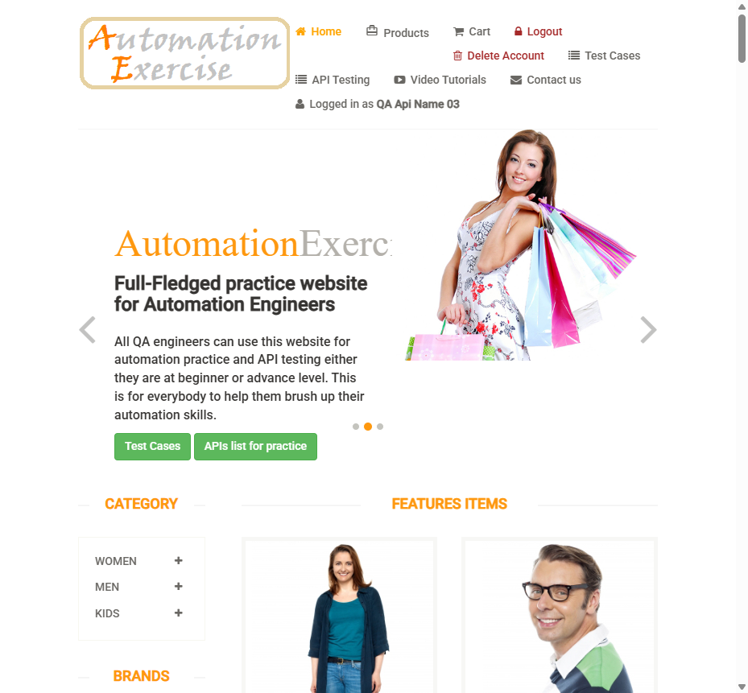

## US Reversa — Login (caixa "Login to your account")

**Observado em:** https://www.automationexercise.com/login\
**Data da análise:** 2026-10-22\
**Fluxo de chegada:** direto (`/login`), com conta criada pela API 11\
**Pré-condições para acessar esta tela:**

  - visitante não autenticado
  - conta existente (para o caminho de sucesso)

### Narrativa
Como cliente cadastrado.\
Quero entrar com e-mail e senha.\
Para que eu acesse minha conta.

> ⚠️ Narrativa inferida por engenharia reversa.
> Validar com PO se reflete a intenção original.

### Critérios de Aceite

**CA01 — Login válido — origem: regra:login-redireciona-home**\
Dado que existe uma conta\
Quando informo e-mail e senha corretos e clico em "Login"\
Então vou para `/` e o menu mostra "Logged in as `<name>`", "Logout" e "Delete Account"

**CA02 — Sessão persiste**\
Dado que estou autenticado\
Quando navego para `/products`\
Então continuo vendo "Logged in as `<name>`"

**CA03 — E-mail com domínio em maiúsculas recusado**\
Dado que existe a conta `x@example-test.invalid`\
Quando faço login com `x@EXAMPLE-TEST.INVALID` e a senha correta\
Então continuo em `/login` com "Your email or password is incorrect!" em vermelho

**CA04 — Logout leva ao login — origem: regra:logout-leva-login**\
Dado que estou autenticado\
Quando acesso "Logout"\
Então vou para `/login`, vejo "Login to your account" e o menu volta a "Signup / Login"; o botão Voltar do navegador não restaura a área logada (confirmado na US-05)

**CA05 — Credenciais inválidas (US-04) — origem: regra:login-mensagem-generica**\
Dado que informo um e-mail sem conta, ou um e-mail existente com senha errada, ou a senha com caixa trocada\
Quando clico em "Login"\
Então continuo em `/login`, sem "Logged in as", com "Your email or password is incorrect!" em vermelho na caixa de login e os campos preenchidos

### Regras de negócio identificadas

| ID | Regra | Categoria | Confiança (tipo) | Evidência |
|----|-------|-----------|------------------|-----------|
| `regra:login-redireciona-home` | Login válido redireciona para a home, autenticado | Navegação/Acesso | 1.0 (fato, confirmado ao vivo) | Observada nesta análise |
| `regra:logged-in-as-usa-campo-name` | "Logged in as" exibe o `name` da conta, também para conta criada pela API | Navegação/Acesso | 1.0 (fato, confirmado ao vivo) | Já registrada em cadastro-conta-us-reversa.md; confirmada também para conta da API |
| `regra:login-mensagem-generica` | Toda falha de login mostra a mesma mensagem, "Your email or password is incorrect!", sem distinguir e-mail inexistente de senha errada. A senha diferencia maiúsculas | Tratamento de erro | 1.0 (fato, confirmado ao vivo em 3 variações, US-04) | Observada nesta análise |
| `regra:logout-leva-login` | Logout encerra a sessão e leva a `/login` | Navegação/Acesso | 1.0 (fato, confirmado ao vivo) | Observada nesta análise (adianta a US-05) |

### Jornada do usuário

**1. Autenticado após o login**\
\
Depois de "Login" com conta da API: "Logged in as QA Api Name 03" (o `name`, não o `firstname` "QA First 03").

### Contexto observado
O cliente informa e-mail e senha na caixa "Login to your account" e é levado à home já autenticado.\
A sessão é mantida ao navegar para outras páginas.\
O mesmo e-mail com o domínio em maiúsculas é recusado como credencial inválida.

### Escopo desta análise
**Coberto nesta análise:** login válido, nome exibido, persistência ao navegar, domínio em maiúsculas, destino do logout.

**Não coberto nesta análise:** senha errada e e-mail inexistente (US-04); expiração de sessão.

### Elementos identificados

#### Componente: Login (`/login`, caixa "Login to your account")
| Elemento | Tipo | Label/ID | Obrigatório | Comportamento observado |
|----------|------|----------|-------------|------------------------|
| Título | h2 | "Login to your account" | — | — |
| E-mail | input email | `[data-qa="login-email"]` | sim | — |
| Senha | input password | `[data-qa="login-password"]` | sim | mascarado |
| Login | button | `[data-qa="login-button"]` | — | POST `/login` |
| Erro | p (vermelho) | dentro do form do login, sem data-qa | — | "Your email or password is incorrect!" |

### Estados observados
- [x] Estado inicial · [x] Sucesso (home autenticada) · [x] Erro (credencial recusada) · [ ] Loading [NÃO OBSERVADO] · [ ] Vazio — não se aplica · [ ] Desabilitado — não se aplica

### GAPs identificados

**3. `/delete_account` sem sessão mostra "Account Deleted!"**\
Depois do logout, acessar `/delete_account` diretamente exibe "Account Deleted!" com o menu de visitante, mas a conta continua existindo (API 14 → 200). É uma confirmação falsa. Registrado como BUG-004 ([bug-report](../bug-report-2026-10-22-delete-account-sem-sessao.md)). Prints: [03-after-logout.png](login-screenshots/03-after-logout.png), [04-delete-account-logged-out.png](login-screenshots/04-delete-account-logged-out.png).

**2. Senha devolvida no HTML após login inválido**\
O POST `/login` com credenciais inválidas responde com o campo de senha preenchido no atributo `value`, ou seja, a senha fica no código-fonte da página. Registrado como BUG-003 ([bug-report](../bug-report-2026-10-22-senha-devolvida-no-html.md)). Print do estado de erro: [02-login-error.png](login-screenshots/02-login-error.png).

**1. Login diferencia maiúsculas no domínio do e-mail**\
Mesma causa raiz do BUG-002 (signup), agora no login. Anexado ao BUG-002 como nova manifestação.
