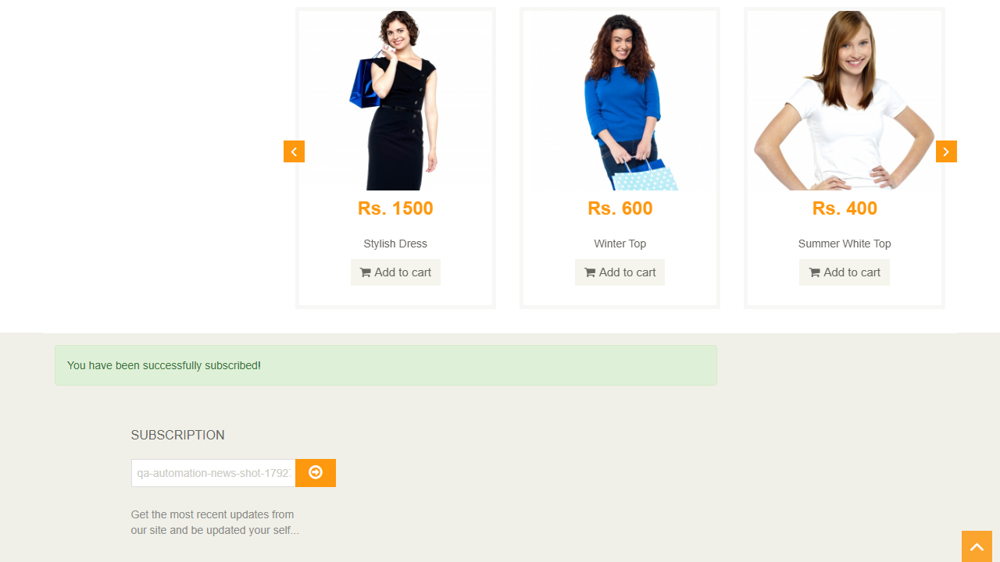

## US Reversa — Assinatura da newsletter (rodapé)

**Observado em:** https://www.automationexercise.com/ (rodapé `#footer`)\
**Data da análise:** 2026-10-22\
**Fluxo de chegada:** direto (home)\
**Pré-condições para acessar esta tela:**

  - nenhuma

### Narrativa
Como visitante.\
Quero informar meu e-mail no rodapé.\
Para que eu receba novidades do site.

> ⚠️ Narrativa inferida por engenharia reversa.
> Validar com PO se reflete a intenção original.

### Critérios de Aceite

**CA01 — Mensagem de sucesso — origem: regra:assinatura-so-visual**\
Dado que estou na home\
Quando informo um e-mail válido em `#susbscribe_email` e clico em `#subscribe`\
Então `#success-subscribe` ("You have been successfully subscribed!") aparece por 1,5 s, depois some e o campo é apagado

**CA02 — E-mail inválido ou vazio**\
Dado que estou na home\
Quando informo um e-mail sem "@" (ou nada) e clico na seta\
Então a validação nativa do navegador bloqueia o envio e nenhuma mensagem aparece

### Regras de negócio identificadas

| ID | Regra | Categoria | Confiança (tipo) | Evidência |
|----|-------|-----------|------------------|-----------|
| `regra:assinatura-so-visual` | O envio do formulário é cancelado no cliente (`return false` em `static/js/subscription.js`); só a mensagem é exibida por 1,5 s. O campo não tem `name`, e nenhuma requisição com o e-mail é feita | Validação | 1.0 (fato: código-fonte do script + rede observada) | Observada nesta análise — GAP (BUG-007), não comportamento correto |

### Jornada do usuário

**1. Mensagem de sucesso**\
\
Logo após clicar na seta: mensagem verde no rodapé.

### Contexto observado
O rodapé da home tem o título "Subscription" (exibido em maiúsculas), um campo de e-mail e um botão com seta.\
Ao enviar um e-mail válido, a mensagem de sucesso aparece por 1,5 s e o campo é apagado.\
Nenhum dado sai do navegador.

### Escopo desta análise
**Coberto nesta análise:** e-mail válido, repetido, inválido, vazio, com espaços; rede; código do script.

**Não coberto nesta análise:** rodapé em outras páginas.

### Elementos identificados
| Elemento | Tipo | Label/ID | Obrigatório | Comportamento observado |
|----------|------|----------|-------------|------------------------|
| Título | h2 | `#footer h2` — "Subscription" | — | maiúsculas por CSS |
| E-mail | input email | `#susbscribe_email` (com a grafia do site) | sim (`required`) | sem atributo `name` |
| Seta | button submit | `#subscribe` | — | sem nome acessível (só ícone) |
| Mensagem | div | `#success-subscribe` | — | classe `hide` removida por 1,5 s |

### GAPs identificados

**1. Assinatura só visual (BUG-007)**\
A mensagem de sucesso aparece sem nenhum registro do e-mail.

**2. Botão sem nome acessível**\
`#subscribe` contém só o ícone `fa-arrow-circle-o-right`, sem texto nem `aria-label`. Observação de acessibilidade, fora dos ACs.
