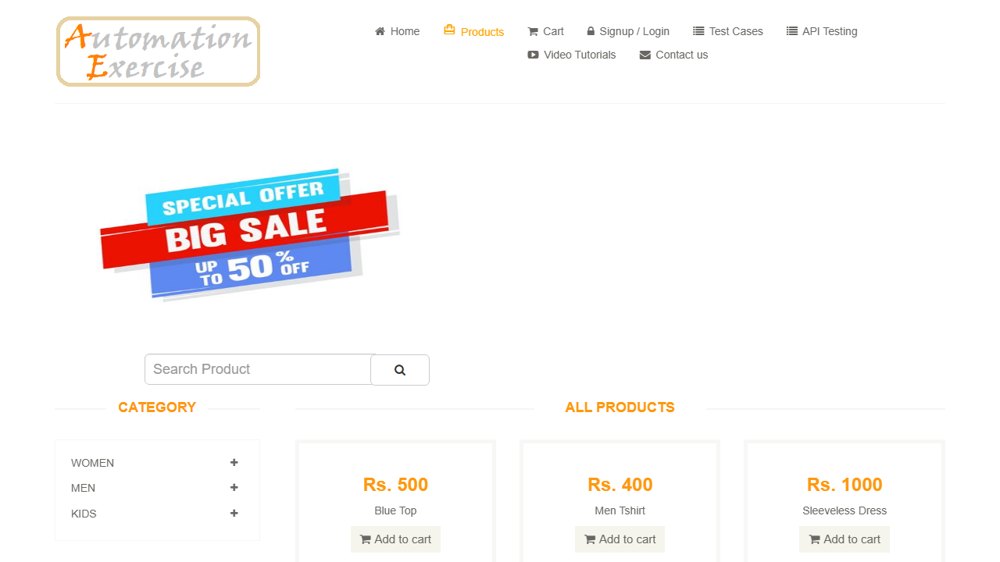
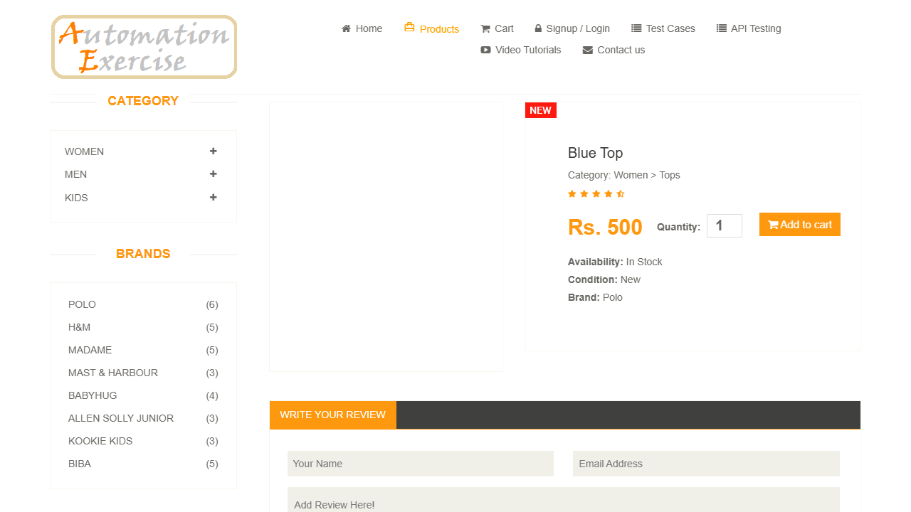
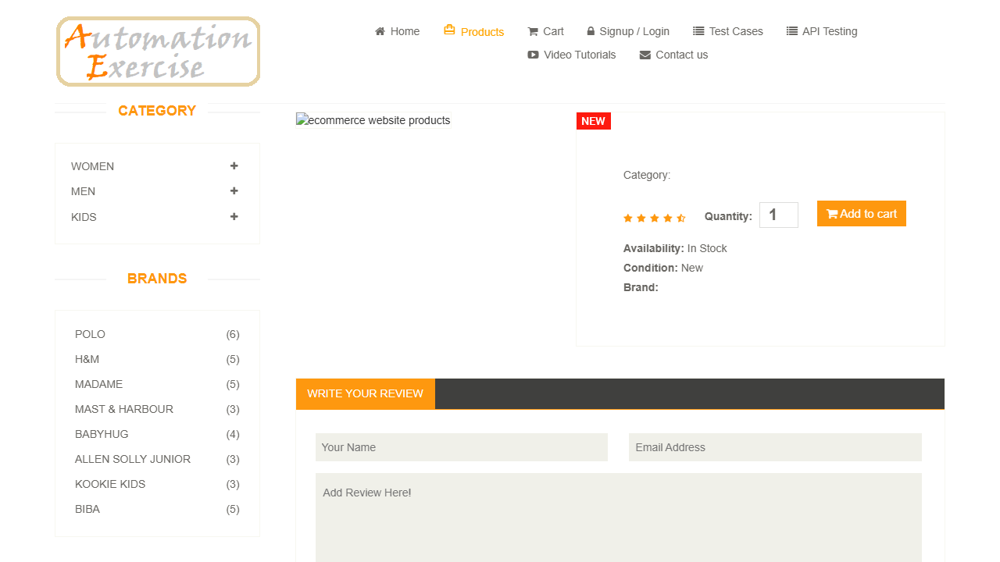

## US Reversa — Produtos (lista "All Products" e detalhe)

**Observado em:** https://www.automationexercise.com/products, /product_details/{id}\
**Data da análise:** 2026-10-22\
**Fluxo de chegada:** com instruções (TC 8: home → "Products" → "View Product")\
**Pré-condições para acessar esta tela:**

  - nenhuma (catálogo público)

### Narrativa
Como visitante.\
Quero ver todos os produtos e o detalhe de um deles.\
Para que eu decida o que comprar.

> ⚠️ Narrativa inferida por engenharia reversa.
> Validar com PO se reflete a intenção original.

### Critérios de Aceite

**CA01 — Lista de produtos**\
Dado que estou na home\
Quando clico em "Products"\
Então vou para `/products`, vejo "All Products" (exibido "ALL PRODUCTS" por CSS) e 34 itens, cada um com nome, preço "Rs. N" e "View Product"

**CA02 — Detalhe do produto — origem: regra:detalhe-corresponde-ao-item**\
Dado que estou em `/products`\
Quando clico em "View Product" do primeiro item ("Blue Top", "Rs. 500")\
Então vou para `/product_details/1` com "Blue Top", "Category: Women > Tops", "Rs. 500", "Availability: In Stock", "Condition: New", "Brand: Polo"

**CA03 — Produto inexistente [GAP]**\
Dado um id que não existe\
Quando acesso `/product_details/99999`\
Então recebo HTTP 200 com o detalhe vazio, mas com "In Stock", "New" e "Add to cart" (BUG-005)

**CA04 — Busca (US-08) — origem: regra:busca-nome-ou-categoria**\
Dado que estou em `/products`\
Quando digito um termo em `#search_product` e clico em `#submit_search`\
Então vou para `/products?search=<termo>`, vejo "Searched Products" (exibido em maiúsculas por CSS) e os produtos cujo nome **ou** categoria contém o termo, sem diferenciar maiúsculas

**CA05 — Busca sem resultado**\
Dado um termo que não existe\
Quando busco\
Então vejo "Searched Products" e nenhum produto, sem mensagem

### Regras de negócio identificadas

| ID | Regra | Categoria | Confiança (tipo) | Evidência |
|----|-------|-----------|------------------|-----------|
| `regra:busca-nome-ou-categoria` | A busca retorna produtos cujo nome ou categoria contém o termo, sem diferenciar maiúsculas; termo vazio volta para "All Products"; espaços à esquerda não são removidos | Validação | 1.0 (fato, confirmado ao vivo com 10 termos) | Observada nesta análise |
| `regra:detalhe-corresponde-ao-item` | "View Product" do item N leva a `/product_details/<id do item>`, com o mesmo nome e preço da lista | Navegação/Acesso | 1.0 (fato, confirmado ao vivo, 4 rodadas) | Observada nesta análise |

### Jornada do usuário

**1. All Products**\
\
34 produtos; primeiro: "Blue Top", "Rs. 500".

**2. Detalhe do primeiro produto**\
\
`/product_details/1`, com os seis dados preenchidos.

**3. Produto inexistente**\
\
`/product_details/99999`: dados vazios, "In Stock" e "Add to cart".

### Contexto observado
O menu "Products" leva à lista de todos os produtos, com nome, preço e um link "View Product" em cada item.\
O link abre o detalhe do produto com categoria, preço, disponibilidade, condição e marca.\
Um id inexistente abre o mesmo modelo de página vazio, ainda oferecendo o produto para compra.

### Escopo desta análise
**Coberto nesta análise:** lista, detalhe do primeiro item, completude da lista, id inexistente.

**Não coberto nesta análise:** busca (US-08), filtros por categoria/marca, avaliação ("Write Your Review"), quantidade e "Add to cart" (US-10/US-11).

### Elementos identificados

#### Componente: Lista (`/products`)
| Elemento | Tipo | Label/ID | Obrigatório | Comportamento observado |
|----------|------|----------|-------------|------------------------|
| Título | h2.title | `.features_items h2.title` — "All Products" | — | exibido em maiúsculas por CSS |
| Item | div | `.features_items .product-image-wrapper` | — | 34 itens |
| Nome / preço | p / h2 | `.productinfo p`, `.productinfo h2` | — | "Blue Top" / "Rs. 500" |
| View Product | link | `a[href^="/product_details/"]` | — | um por item, ids únicos |
| Busca | input / button | `#search_product`, `#submit_search` | — | (US-08) |

#### Componente: Detalhe (`/product_details/{id}`)
| Elemento | Tipo | Label/ID | Obrigatório | Comportamento observado |
|----------|------|----------|-------------|------------------------|
| Nome | h2 | `.product-information h2` | — | — |
| Categoria / Disponibilidade / Condição / Marca | p | `.product-information p` com "Category:", "Availability:", "Condition:", "Brand:" | — | texto "Rótulo: valor" |
| Preço | span | `.product-information span > span` | — | "Rs. 500" |
| Add to cart | button | `.product-information button.cart` | — | (US-10/US-11) |

Sem `data-qa` nas páginas de produto. Seletores por estrutura e por rótulo de texto.

### Estados observados
- [x] Estado inicial (lista e detalhe) · [x] Estado "vazio" (produto inexistente, GAP) · [ ] Loading [NÃO OBSERVADO] · [ ] Erro — não há página de erro (GAP)

### GAPs identificados

**3. Busca não ignora espaços nas pontas**\
` Top` → 12 resultados (perde os 2 por categoria) e `  Top` → 0, contra 14 de `Top`. O espaço à direita não chega ao servidor. BUG-006 (Low, oráculo de convenção de mercado).

**4. Busca sem resultado não tem mensagem**\
Só o título "SEARCHED PRODUCTS" com área vazia. Observação de UX, sem promessa do produto. Não é bug. [05-search-no-results.png](produtos-screenshots/05-search-no-results.png)

**1. Produto inexistente oferecido para compra**\
`/product_details/99999` responde 200 com nome/categoria/marca vazios, mas "Availability: In Stock", "Condition: New" e "Add to cart". BUG-005.

**2. Vignette de anúncio intercepta navegação**\
Não apareceu nas 4 sondagens, mas apareceu na execução do TC08 (4 em 71): o clique em "Products" virou `/#google_vignette`. Diagnóstico FLK-001; a suíte bloqueia os hosts de anúncio (MEM-002).
